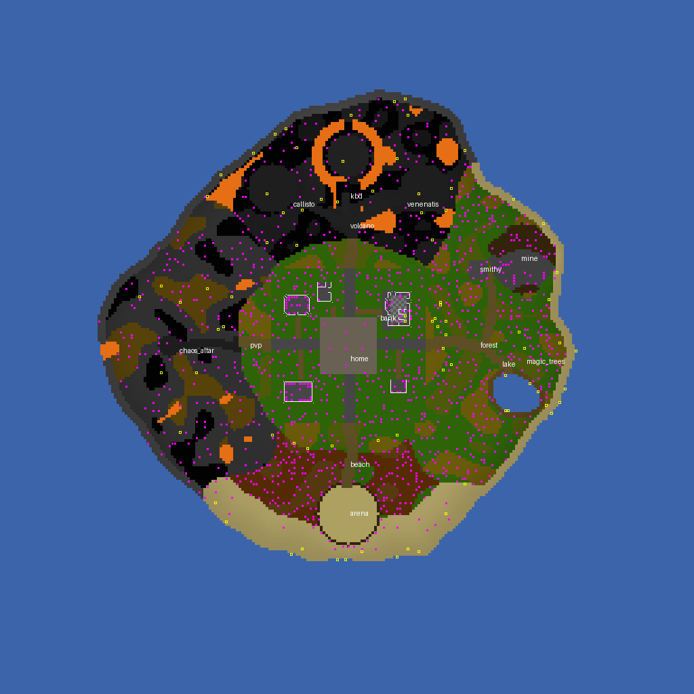

# RELOAD wereld

Eigen wereld van 256 x 256 tegels (4 x 4 mapregio's) voor RELOAD RSPS, los van de bestaande RuneScape-kaart.
Ligt op x 3840-4095, y 1664-1919. De oude wereld blijft gewoon bestaan.



## Zones

| Zone | Wat staat er | Commando |
|---|---|---|
| Home (midden) | plein met fontein, bank, winkel, drie huizen, marktkramen, altaar | `::zone home`, `::zone bank` |
| Bos (oost) | bomen, eiken, esdoorns, taxussen, magic trees, meer met wilgen en visplekken | `::zone forest`, `::zone lake`, `::zone magictrees` |
| Mijn (noordoost) | koper t/m runite, oven, aambeelden, bankkist | `::zone mine`, `::zone smithy` |
| Vulkaan (noord) | demonen, hellhounds, fire giants, draken; drie baasarena's | `::zone volcano`, `::zone callisto`, `::zone venenatis`, `::zone kbd` |
| Kust (zuid) | jungle, strand, rock crabs, zee-visplekken, arena met pilaren | `::zone beach`, `::zone arena` |
| Woestenij (west) | PvP-zone (telt als Wilderness level 20), chaos altar | `::zone pvp`, `::zone chaosaltar` |

`::zone` zonder naam geeft de lijst. Ontwikkelaars kunnen ook `::tele 3968 1787`.

## Home vast instellen

Nieuwe spelers, doodgaan en de home-teleport gebruiken `GameConstants.DEFAULT_LOCATION`. Zet die op:

```java
public static final Location DEFAULT_LOCATION = new Location(3968, 1787);
```

Dat is bewust niet automatisch gedaan, omdat de home lokaal al is aangepast.

## Hoe het werkt

- Server: 32 mapbestanden in `ElvargServer/data/clipping/maps/3700.dat` t/m `3731.dat`, 16 regio's toegevoegd aan `data/clipping/map_index`.
- Client: dezelfde bestanden los in `ElvargClient/Cache/reload_maps/`. `ResourceProvider` leest die map eerst; de cache zelf is niet aangepast.
- NPC's: `ElvargServer/data/definitions/npc_spawns_reload_world.json`, wordt na `npc_spawns.json` ingeladen.
- Coordinaten en PvP-grenzen: `ReloadWorld.java` (gegenereerd).

## Aanpassen en opnieuw genereren

```
pip install numpy scipy pillow
python3 tools/reload-world/generate.py
```

Alles staat in `generate.py`: kustlijn, biomen, wegen, gebouwen, objecten en spawns. Dezelfde `SEED` geeft exact dezelfde bestanden.
De gebouwen in het dorp zijn uit Edgeville gekopieerd (`stamp(...)`); met dezelfde functie is elk bestaand gebouw over te nemen.

## Bekend

- De kustlijn en lavaranden bestaan uit hele tegels, dus ze zijn hoekig van dichtbij.
- De wereldkaart (het kaart-icoon) kent dit gebied niet.
- Ladders in de gekopieerde huizen doen alleen iets als de server die ladder-id's afhandelt.
